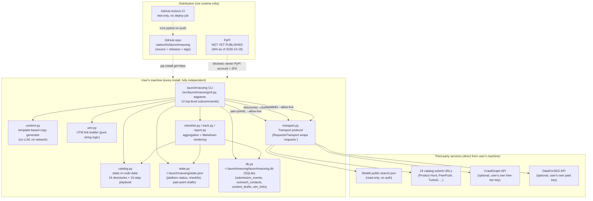

# launchmaxxing — Architecture (2026-10-23)

Scope note: this doc covers competitive positioning context, user research
grounding, and technical architecture only. Feature/page/API planning lives
in `PLAN-2026-10-23-DEEP.md` if/when another workflow writes it (it did not
exist at the time this doc was written — no duplication to avoid).

## 0. What this product actually is

Confirmed by reading the repo, not assumed:

- Pure Python 3.10+ CLI tool (`src/launchmaxxing/`, 2,397 lines across 15
  modules), installed as a `pip` package with one console-script entry
  point: `launchmaxxing = launchmaxxing.cli:main` (`pyproject.toml`).
- **No server. No web app. No Docker. No Oracle box. No Cloudflare
  Worker/Page.** Grepped for Flask/FastAPI/Django/uvicorn — zero hits.
  Found no `Dockerfile`/`docker-compose*` anywhere in the repo.
- CI (`.github/workflows/`) runs `pytest` on push/PR only — no deploy or
  publish job exists.
- Distribution target today is GitHub (`github.com/caelum0x/launchmaxxing`,
  confirmed via `git remote -v`) plus `pip install git+https://...@<tag>`.
  PyPI publish is NOT live — `RELEASE.md` confirms `pypi.org/pypi/
  launchmaxxing/json` 404s as of 2026-10-19, blocked on an owner-only PyPI
  account + 2FA + token step.
- Persistence is 100% local to the end user's machine: one JSON file
  (`~/.launchmaxxing/state.json`) plus one SQLite file
  (`~/.launchmaxxing/launchmaxxing.db`). Both overridable via env vars
  (`LAUNCHMAXXING_STATE`, `LAUNCHMAXXING_DB`) or `--state-file`/`--db-file`.
  Nothing is centrally hosted; there is no multi-tenant database and no
  "our infra" to scale — the product's entire install base runs N
  independent copies with zero shared backend.
- The only outbound network calls are to **third-party** endpoints the
  user's own machine makes directly, never through any launchmaxxing
  server: Reddit's public `search.json`, each catalog platform's submit
  URL (for `--check-links`), and optional CrawlGraph/DataForSEO backlink
  APIs if the user supplies their own key.

This matters for the strategy doc's growth moves: there is no "our
deployment" to point ad traffic or SEO at beyond the GitHub repo and
README — distribution success is measured in GitHub stars/clones/pip
installs, not page views on an owned domain.

## 1. System diagram

## 2. Data-flow for the 2-3 most important user actions

### 2a. `launchmaxxing submit <product> <platform> <status>` (core loop — record a directory submission)
1. User runs the CLI; argparse (`cli.py`) routes to the `submit` handler.
2. Handler opens `state.json` via `state.load()` (reads local file, or
   returns an empty dict if missing/corrupt — never crashes on first run).
3. `state.set_platform_status()` validates `platform_id` against
   `catalog.PLATFORM_BY_ID` and `status` against `state.PLATFORM_STATUSES`,
   mutates the in-memory dict, sets `submitted_at`/`updated_at`.
4. `state.save()` writes the whole JSON file back to disk (full
   overwrite, not append — this is the "current status" snapshot layer).
5. In parallel, `db.connect()` opens/creates the SQLite file, then
   `db.log_submission_event()` INSERTs one immutable history row into
   `submission_events` (append-only; this is what powers
   `submit --history`, separate from the JSON snapshot in step 4).
6. CLI prints a one-line confirmation to stdout. No network call anywhere
   in this path.

### 2b. `launchmaxxing directories --check-links` (catalog self-verification — the tool's differentiator vs SubmitFleet's 0/339 adapters)
1. CLI loads `catalog.PLATFORMS` (static in-code tuple, no I/O).
2. For each of the 24 platforms, `linkcheck.check_one()` calls
   `transport.request("GET", url, headers={"User-Agent": ...})` — a real
   outbound HTTPS GET straight from the user's machine to the directory's
   own submit URL (e.g. `https://www.launchingnext.com/submit/`).
3. `RequestsTransport` (the only concrete `Transport` implementation
   shipped) wraps Python's `requests` library with a 15s timeout.
4. Response status/redirect chain is classified: `ok=True` for <400,
   flagged with "redirected to X" if the final URL differs (the exact
   mechanism that caught the `launching_next` stale-URL bug fixed in
   0.2.4, and the `/submit`→`/login` redirects already encoded as notes
   for devhunt/turbo0/peerpush/etc.).
5. `linkcheck.broken()` filters to failures; CLI renders a table to
   stdout. Nothing is persisted — this is a live, stateless check, run
   fresh every invocation.

### 2c. `launchmaxxing track <product>` → `launchmaxxing report <product>` (dashboard/report — what a founder shares with a cofounder/investor)
1. `track.build()` reads BOTH stores for the same product: `state.load()`
   for platform/checklist status, `db.connect()` + `list_outreach_contacts`
   / `list_content_drafts` / `list_utm_links` for SQLite history.
2. Cross-references `catalog.PLATFORMS`/`PLAYBOOK_STEPS` against saved
   status to compute `submitted_or_live`, `not_started`, and a **stale**
   list (platforms never started, product tracked ≥N days — default
   via `--stale-days`) using `state.get_product_created_at()` as the
   clock start.
3. `db.stale_outreach_contacts()` adds a second staleness signal: contacts
   stuck in `contacted` status for ≥5 days with no reply.
4. Returns one aggregated dict; `report.render_markdown()` turns that dict
   into a single static Markdown string (no templating engine, just
   f-strings/list joins) printed to stdout or redirected to a file by the
   user's shell (`> report.md`). No network, no server round-trip — the
   "shareable report" is just a text file the user chooses where to put.

## 3. Real architectural risks / bottlenecks (given current scale + $0 budget)

- **No multi-device sync.** State is a single JSON file + single SQLite
  file per machine. A founder using a laptop and a desktop has two
  disconnected histories; there's no merge path. Low cost to accept at
  current (effectively zero) user count, but it's the first thing that
  breaks if a user asks "why doesn't my other machine see this."
- **JSON-file state is full-rewrite, not append.** `state.save()` writes
  the entire file on every mutating command. Fine at the file sizes one
  founder's launch tracking produces. The crash-mid-write corruption risk
  this used to carry is fixed as of 0.2.6 (`save()` now writes to a
  temp file + `os.replace()`, see §4.1) — the remaining residual risk is
  only "no backup/rotation of prior versions", not data corruption.
- **Catalog accuracy is a manual-labor bottleneck disguised as a feature.**
  The CHANGELOG shows 3+ releases (0.1.0→0.2.1→0.2.2→0.2.4) fixing stale
  URLs/wrong `account_free` tags, each only caught because `--check-links`
  was run or a human manually hit a 404. With 24 hardcoded directory
  entries and zero paid monitoring, catalog drift (directories changing
  URLs, adding paywalls) will keep recurring and nothing currently runs
  `--check-links` on a schedule — it only runs when a human remembers to.
- **Distribution is capped by the PyPI gap.** Today's install path (`pip
  install git+https://github.com/caelum0x/launchmaxxing@v0.2.4`) is a real
  conversion-funnel drop-off vs. `pip install launchmaxxing`. This is the
  single biggest friction point the strategy doc also flags, and it is
  explicitly owner-gated (PyPI account + 2FA) — not something more code
  can route around.
- **Reddit search has no caching/backoff beyond a bare 429 check.**
  `reddit_search.search()` makes one live HTTP call per subreddit per
  invocation with no local cache of recent results and no exponential
  backoff — a user running `pain-points` repeatedly against the same
  query/subreddit list will re-hit Reddit's endpoint every time and is
  one aggressive-usage pattern away from a 429 loop. Not costly at today's
  usage, but it's the only place in the codebase where "no budget, no
  server" collides with "an external service could rate-limit us."
  Also unauthenticated — if Reddit tightens anonymous `search.json`
  access, this path breaks for every installed copy simultaneously with
  no server-side mitigation possible (it's each user's own IP hitting
  Reddit).
- **No usage telemetry at all (by design) means zero visibility into the
  funnel the strategy doc wants to move.** There is no way to know, from
  the tool itself, how many people `pip install`ed, ran `init` vs. never
  got past `--help`, or hit a broken directory URL in the wild. GitHub
  stars/clones and PyPI download stats (once published) are the only
  available proxies, and PyPI isn't live yet — so even the growth moves in
  the strategy doc are currently unmeasurable from first-party data.

## 4. Prioritized next-build list (effort vs. impact)

1. ~~**Atomic state-file writes.**~~ Shipped 0.2.6 (2026-10-23):
   `state.save()` now writes to a `tempfile.mkstemp` temp file in the same
   directory, `fsync`s it, then `os.replace()`s into place; on error the
   temp file is removed and the original is untouched. 2 new tests,
   214/214 passing.
2. **Self-schedulable `--check-links` (small effort, directly serves the
   dogfooding growth move).** Add a documented `cron`/`launchd` one-liner
   (or a `launchmaxxing directories --check-links --json` machine-readable
   output flag) so a user — or this portfolio's own Oracle boxes — can run
   the existing live check on a recurring basis and catch the next stale
   URL automatically instead of waiting for a manual report. Reuses 100%
   of existing `linkcheck.py` logic; no new network surface.
3. **Finish self-submission to the 6 unused 2026 directories named in the
   strategy doc (PeerPush, Turbo0, Smol Launch, StartupBase, Microlaunch,
   Findly Tools) and log it exactly like prior entries in
   `launch-evidence/` + CHANGELOG.** This is pure dogfooding work, zero
   new code, directly executes growth move #2 from the strategy doc, and
   produces the comparison-table ammunition for growth move #3 (proof
   this tool's own catalog notes are more accurate than SubmitFleet's 0/339
   or OpenLaunch's unverified list).
4. **PyPI publish readiness package (medium effort, owner-gated execution
   but code-side prep is not).** Pre-write the `publish.yml` GitHub Actions
   workflow (trusted-publishing variant per `RELEASE.md` section 6) now, so
   the only remaining owner step is the PyPI account + 2FA click-through —
   not also waiting on workflow authoring. Highest-leverage single item
   once unblocked: directly fixes the "pinned git+https install" friction
   point named in both this doc and the strategy doc's differentiation
   list.
5. **Lightweight local Reddit-search result cache (medium effort, risk
   mitigation not a feature).** Cache `pain-points` results for a given
   query+subreddit set in SQLite with a short TTL (e.g. 1 hour) before
   re-hitting `search.json`. Protects every installed copy from an
   avoidable 429 loop during repeated/testing use, at the cost of one new
   small table in `db.py` and a cache-check branch in
   `reddit_search.search()` or the CLI handler that calls it.
